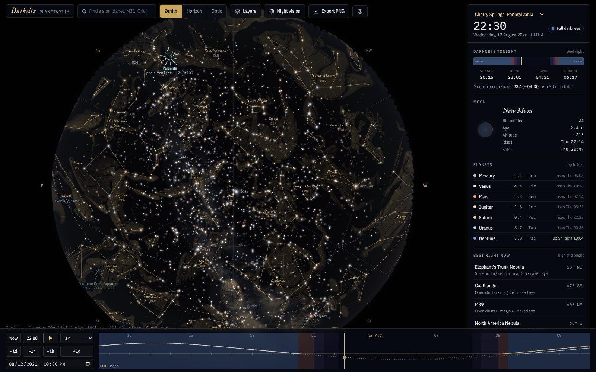
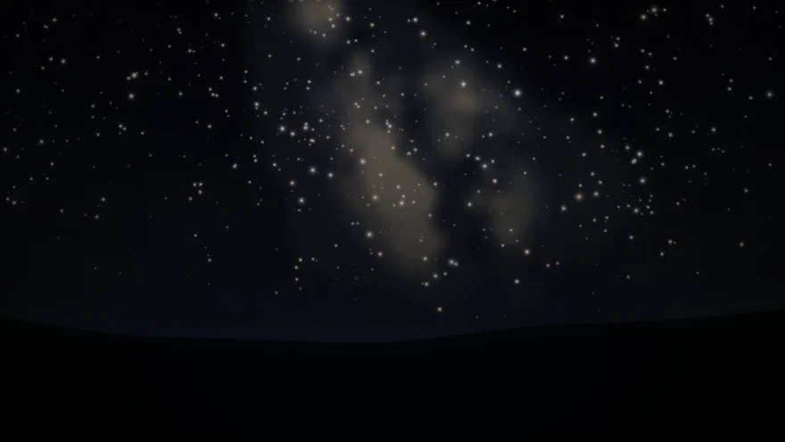
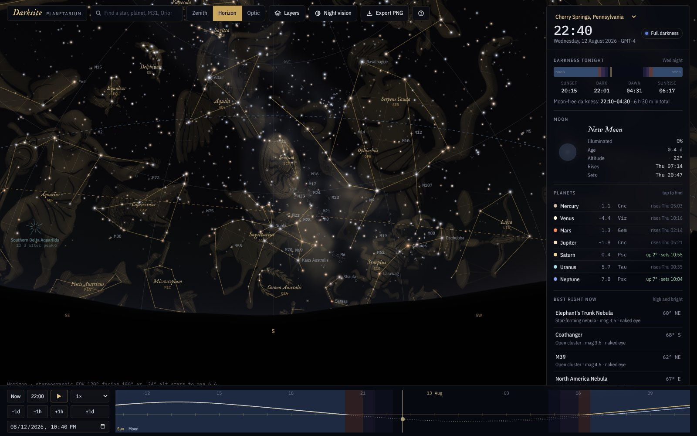
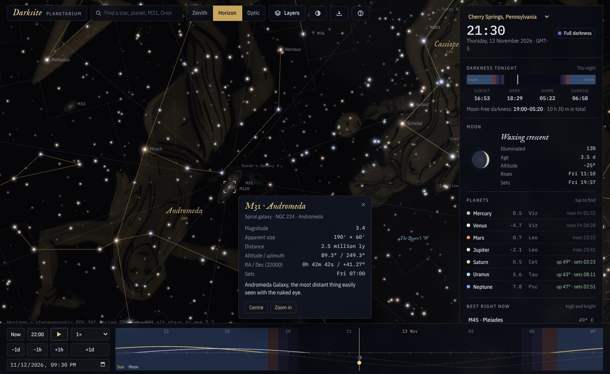
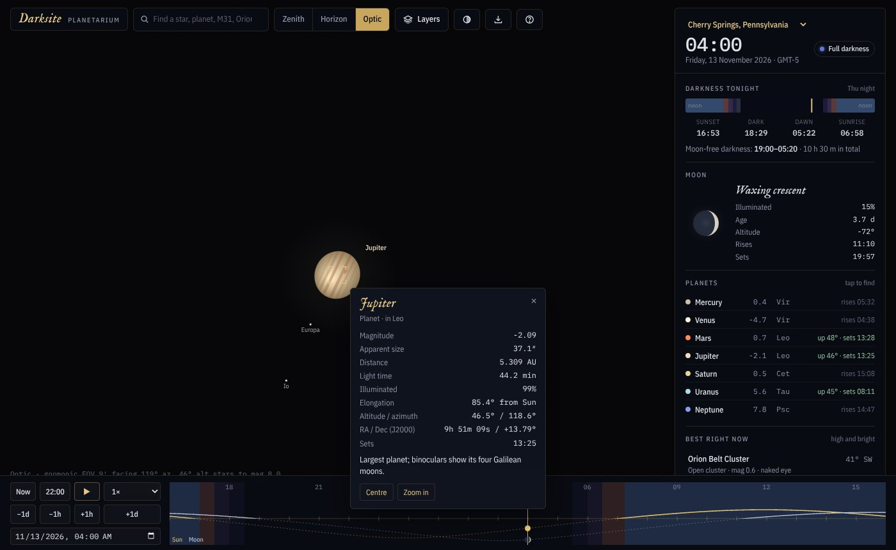
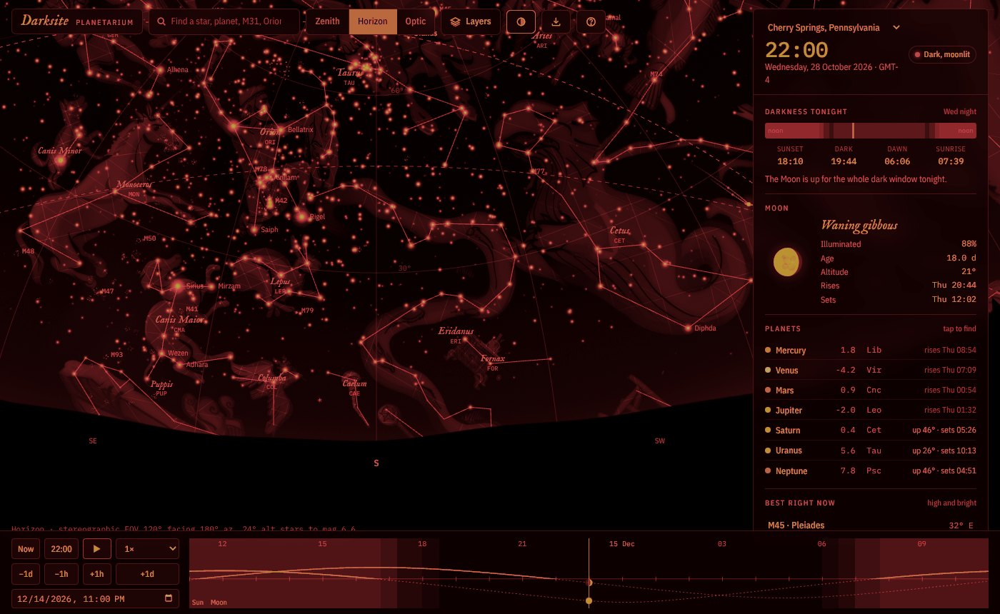
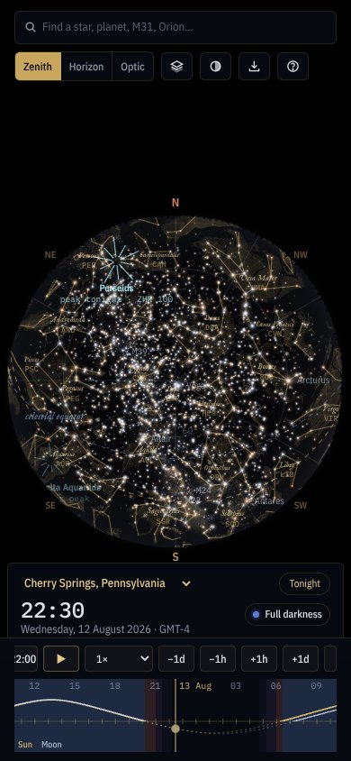
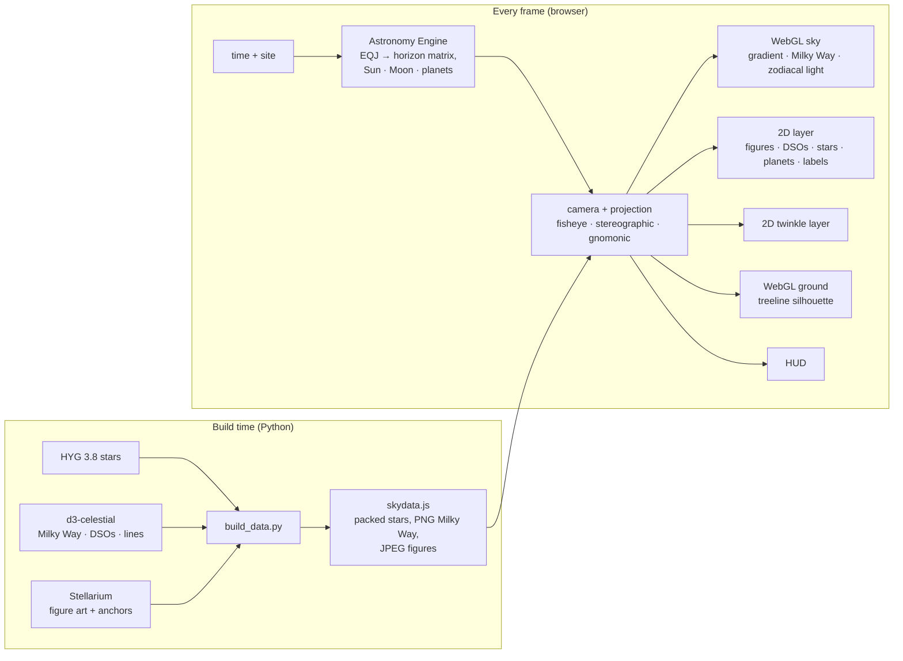

<div align="center">



# Darksite

**A real-time planetarium for dark-sky observers, in a single HTML file.**

41,000 stars · the Milky Way · Stellarium constellation art · 1,100 deep-sky objects · planets, moons and meteor showers · a live *Tonight* ledger

[Watch the film](#the-film) · [Open the app](#open-it) · [What you can see](#whats-in-the-sky) · [How it works](#how-it-works) · [Build from source](#build-from-source) · [Contribute](#contributing)


</div>

---

Darksite is meant to feel like standing in a field at 22:00, not like reading a diagram. Stars carry their true colours and dim and redden toward the horizon. The Milky Way brightens toward Sagittarius and fades when the Moon rises. Constellations are drawn as faint gold engravings, and the sky changes as you scrub through the night.

## The film

<p align="center">
  <a href="docs/media/darksite-film.mp4"></a>
</p>
<p align="center"><sub>A 25-second film made entirely from the app's own renders, with an original score. <a href="docs/media/darksite-film.mp4"><b>▶ Watch the full film</b></a> (1280×720, with sound).</sub></p>

## Open it

| | |
|---|---|
| **Locally** | Download [`dist/index.html`](dist/index.html) and open it in any modern browser. It needs a network connection the first time, for the ephemeris library and fonts. |
| **Hosted** | Every push to `main` deploys to GitHub Pages: [tanmaycj.github.io/Darksite-Planetarium](https://tanmaycj.github.io/Darksite-Planetarium/) once Pages is enabled (Settings → Pages → Source: GitHub Actions). |
| **Embedded** | `dist/darksite.html` is the same app without its own `<head>`, ready to drop into a host page. |

The app opens at **22:00 tonight** from the dark-sky site nearest your time zone, with the clock running.

## A tour

<table>
  <tr>
    <td width="50%"></td>
    <td width="50%"></td>
  </tr>
  <tr>
    <td><b>Horizon view.</b> The galactic core over Sagittarius, Messier objects at true size, airmass extinction near the treeline, and the darkness timeline in the sidebar.</td>
    <td><b>Find anything.</b> Search for “M31” and the view flies to it. The Andromeda Galaxy appears as a tilted ellipse at its real 3° size, with IAU boundaries and asterisms switched on.</td>
  </tr>
  <tr>
    <td></td>
    <td></td>
  </tr>
  <tr>
    <td><b>Telescope zoom.</b> Optic view goes down to a 5′ field. Jupiter shows its bands along its real pole and its four Galilean moons; Saturn's rings tilt as they really do.</td>
    <td><b>Night vision.</b> One tap turns everything red to protect your dark adaptation at the eyepiece.</td>
  </tr>
</table>

<p align="center"></p>
<p align="center"><sub>On a phone: drag to look around, pinch to zoom, and the ledger becomes a bottom sheet.</sub></p>

## What's in the sky

| Layer | Detail |
|---|---|
| **Stars** | 41,487 stars to magnitude 8 (HYG 3.8). Colour comes from the measured B−V index. Brightness falls off with airmass, and stars redden near the horizon and twinkle below 30°. Zooming in reveals fainter stars, as binoculars or a telescope would. |
| **Milky Way** | Rendered per pixel in WebGL from five brightness contours, boosted toward the galactic centre, with the Great Rift visible. It fades under moonlight, twilight and light pollution. |
| **Constellations** | All 88, with Stellarium's “modern” figure art mapped onto the sky through its anchor stars, plus figure lines, Latin names with IAU abbreviations, IAU boundaries and 42 named asterisms. |
| **Deep sky** | 110 Messier objects and about 1,000 NGC, IC and Caldwell objects at true angular size: galaxies as tilted ellipses, nebulae as soft glows, globulars as tight point clouds, planetaries as rings, dark nebulae as shadows. |
| **Solar System** | The Sun; the Moon as a true-size phase disc with earthshine; all seven planets with phases; Jupiter's bands and the Galilean moons; Saturn's rings at their real tilt; and paths of up to ±120 days across the zodiac. |
| **Atmosphere** | Twilight and daylight sky, moonlight scattering, airglow, zodiacal light and gegenschein, a distant town glow, and a Bortle 1–9 sky-quality setting that changes what you can see. |
| **Reference** | Ecliptic, celestial equator, alt/az grid every 30°, cardinal points, meteor-shower radiants while each shower is active, and an eyepiece scale bar when zoomed in. |

### The *Tonight* ledger

- **Darkness tonight:** sunset, astronomical dusk and dawn, sunrise, and the moon-free dark window on a 24-hour bar.
- **Moon:** phase, illumination, age, altitude, and rise and set times.
- **Planets:** magnitude, constellation, and whether each is up or when it rises. Tap one to fly to it.
- **Best right now:** the brightest deep-sky targets more than 25° up, each tagged as a naked-eye, binocular or telescope object, plus any active meteor shower.
- **Next two hours:** constellations rising and setting.
- **Conjunction alert:** any planet within 5° of a named star or another planet.
- **Next 7 days:** Moon phases, perigee and apogee, oppositions, greatest elongations, lunar and solar eclipses, lunar occultations of bright stars and planets, close approaches and meteor-shower peaks. Tap an event to jump to it.

### Controls

| Action | Mouse / touch | Keyboard |
|---|---|---|
| Look around | Drag | `←` `→` `↑` `↓` |
| Zoom | Wheel · pinch | `+` `−` |
| Details | Click · tap an object | |
| Search | | `/` |
| Projection | Zenith · Horizon · Optic | `1` `2` `3` |
| Time | Drag the timeline · speed menu | `Space` play/pause · `[` `]` ±1 h · `T` now |
| Layers · night vision · help | Toolbar | `L` · `N` · `?` |

## How it works

Every object is stored once as a J2000 unit vector. Each frame, [Astronomy Engine](https://github.com/cosinekitty/astronomy) supplies the rotation from J2000 to the observer's horizon, which includes precession, nutation and the observer's location. The planets and Moon are computed topocentrically, so lunar parallax is right for your site.



Some details worth knowing:

- **Constellation art** is drawn as a 6 × 6 mesh per figure. Three anchor stars fix an affine map from image pixels to the tangent plane, and each triangle is then projected and texture-mapped, so the figures bend correctly in the fisheye view.
- **The Milky Way** is rasterised once in galactic coordinates, where the band is a strip, and resampled to RA/Dec. The shader samples it through the inverse projection, so there are no seams at any field of view.
- **Labels** are queued with priorities and placed with collision avoidance, so planet and bright-star names win over faint deep-sky labels.
- **It stays usable when things go wrong.** Without WebGL 2 it falls back to a 2D sky, it recovers from lost graphics contexts, it drops figure detail while you drag, and every layer and panel section is isolated so one error cannot blank the sky.

## Build from source

You need Python 3.9+ with `numpy` and `Pillow`, Node 18+, and `curl`.

```bash
git clone https://github.com/TanmayCJ/Darksite-Planetarium.git
cd Darksite-Planetarium
pip install numpy pillow
npm install && npx playwright install chromium
npm run build:all   # fetch pinned catalogues → build data → assemble dist/
npm test            # headless smoke test
npm run serve       # http://localhost:8080
```

After editing only `src/`, `npm run build` reassembles `dist/` in under a second.

```
src/template.html   page shell, CSS tokens, layout
src/app.js          the whole app
tools/              fetch, build, assemble, smoke test, screenshots
dist/               the built single-file app (committed)
docs/images/        these illustrations
```

## Accuracy and limits

- Positions agree with Astronomy Engine, which is good to about an arcminute for planets. Atmospheric refraction is not applied, so objects within a degree of the horizon sit slightly lower than you will see them.
- Lunar occultations and close approaches are found in 20- to 60-minute steps, so their listed times are approximate.
- NGC and IC galaxies have no position angle in the source catalogue, so they are drawn aligned north–south. Messier distances, position angles and descriptions are hand-curated approximations; corrections with a source are welcome.
- The treeline and the distant town glow are stylised, not taken from a real horizon.

## Credits

Darksite stands on generous open data and code:

- **[HYG Database](https://github.com/astronexus/HYG-Database)** by David Nash: stars (CC BY-SA 4.0)
- **[d3-celestial](https://github.com/ofrohn/d3-celestial)** by Olaf Frohn: Milky Way, deep-sky catalogue, lines, boundaries, asterisms (BSD-3)
- **[Stellarium](https://stellarium.org)**: “modern” sky-culture illustrations by Johan Meuris (Free Art License 1.3)
- **[Astronomy Engine](https://github.com/cosinekitty/astronomy)** by Don Cross: ephemerides (MIT)
- **IM Fell English** and **IBM Plex** typefaces (SIL OFL 1.1)

The code is [MIT-licensed](LICENSE). The bundled data keeps its own licenses; see [DATA_LICENSES.md](DATA_LICENSES.md).

## Contributing

Bug reports with a site and time, data corrections with a source, new layers, and better descriptions are all welcome. Everything you need to set up, build, test and open a pull request is in **[CONTRIBUTING.md](CONTRIBUTING.md)**. Please also read our [Code of Conduct](CODE_OF_CONDUCT.md), and report security issues privately as described in [SECURITY.md](SECURITY.md).

<div align="center"><sub>Made by <a href="https://github.com/TanmayCJ">Tanmay CJ</a> and contributors · Clear skies.</sub></div>
